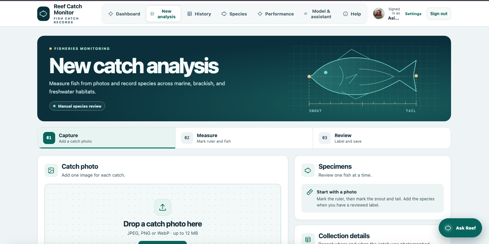
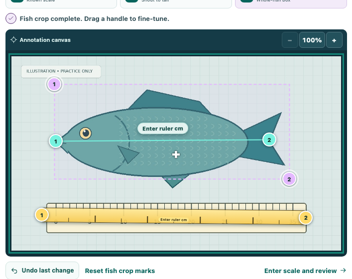
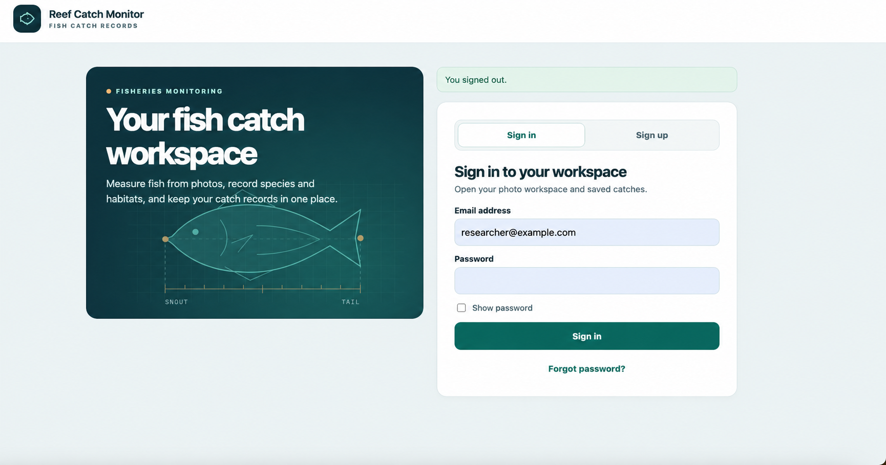
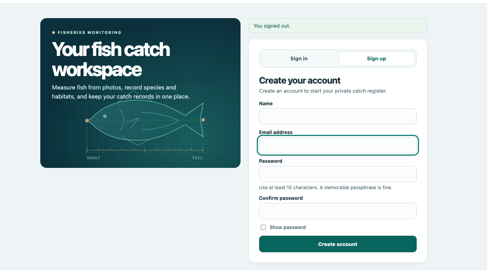
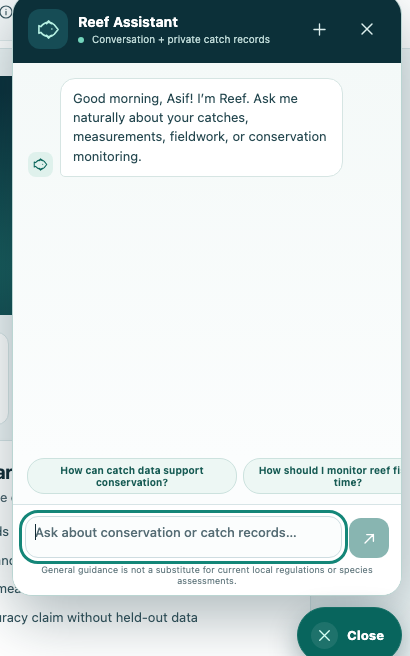

# Reef Catch Monitor

[](https://github.com/kamalchitrali/reef-catch-monitor/actions/workflows/ci.yml)

A research-oriented catch-monitoring app for Pakistan's marine, brackish, and freshwater fisheries. It supports fieldwork along the Arabian Sea coast and across the Indus basin while remaining usable for other study areas. React provides the review workspace; FastAPI validates uploads, reports capture quality, computes only calibrated lengths, and stores predictions separately from researcher reviews.

It combines photo annotation, on-image ruler calibration, researcher-reviewed species labels, private catch records, CSV export, conservation guidance, password recovery, and a transparent trainable species-classification baseline. The application avoids claiming biological accuracy until a representative held-out field dataset has been evaluated.

## Pakistan fisheries focus

The interface suggests Pakistani locations and a small reviewed-label vocabulary spanning marine and inland fisheries: Indian mackerel (*Rastrelliger kanagurta*), hilsa (*Tenualosa ilisha*), rohu (*Labeo rohita*), catla (*Catla catla*), and mrigal (*Cirrhinus mrigala*). These are entry suggestions only. A researcher must verify every label, and the photo model supports a species only after training and held-out evaluation on representative local images.

The geographic framing follows Pakistan government material describing important coastal catches in the northern Arabian Sea and freshwater fisheries in the Indus system. See the [Ministry of Climate Change aquatic-ecosystem chapter](https://mocc.gov.pk/SiteImage/Misc/files/Chapter-04.pdf) and the [Punjab Fisheries manual](https://punjabfisheries.gov.pk/doc/fisheriesmanual.pdf).

## Screenshots

| New catch analysis | Ruler and fish markers |
| --- | --- |
|  |  |

| Sign in | Create an account |
| --- | --- |
|  |  |

<p align="center">
  
</p>

## Run the app

Use Python 3.11+ and Node.js 22+. In VS Code, open the repository root and run:

```bash
python3 -m venv .venv
source .venv/bin/activate
python -m pip install -r backend/requirements-dev.txt
python -m uvicorn backend.main:app --host 127.0.0.1 --port 8000
```

In Windows PowerShell, use `.venv\Scripts\Activate.ps1` to activate the environment. Open [the app](http://127.0.0.1:8000) or [the API documentation](http://127.0.0.1:8000/docs). The database is created under `data/`. Set `REEF_DATA_DIR` to use a separate directory for a field pilot.

In a second terminal run `npm --prefix frontend ci` once, then `npm run dev` from the repository root. Open [the Vite dev server](http://127.0.0.1:5173). Run `npm run build` to update the files served by Python. Configuration belongs in environment variables; copy `.env.example` as a starting point and never commit real passwords.

SQLite is the convenient local default. Set `REEF_DATABASE_URL=postgresql://...` for PostgreSQL. Forward-only migrations run at startup and retain the original catch JSON/photo while indexing fish, predictions, measurements, model versions, and reviews in relational tables. Before upgrading a real installation, stop writes and back up the data directory/database.

## Create an account

Choose **Sign up**, enter your name and email address, and choose a password of at least 15 characters. Registration signs you in. Each account can access only its own catches, photos, avatar, reviews, and CSV exports. Account settings support a profile image, display-name changes, data export, password changes that revoke other sessions, and password-confirmed permanent account deletion. Account deletion cascades to that account's catches, photos, measurements, predictions, and reviews.

**Forgot password** creates a single-use token that expires after 30 minutes and invalidates existing sessions when used. Configure the `REEF_SMTP_*` and `REEF_RESET_BASE_URL` variables from `.env.example` for email delivery. Local developers may explicitly set `REEF_DEV_SHOW_RESET_TOKEN=1` to show the token in the reset form; never enable that option in production. Passwords are salted one-way hashes and can be replaced, never retrieved or displayed.

## Reef Assistant chatbot

Select **Ask Reef** from any signed-in page for a conversational helper with greetings, follow-up context, a visible thinking state, and suggested questions. It understands common ways of asking about catch totals, species, sites, habitats, lengths, weights, recent catches, missing data, photo measurement, model training, and fisheries-conservation monitoring.

Reef is deliberately private and evidence-bounded. The server classifies the request and composes an answer from the signed-in user's own catch records or the app's reviewed guidance; it does not send conversations or catch data to an external language-model service. Record-based answers are separated from general conservation guidance, and the interface reminds users to confirm current local regulations and species assessments. It is a project assistant, not a substitute for expert identification, fisheries regulation, or scientific review. See [Chatbot design and supported questions](docs/CHATBOT.md) for details.

If you already ran the single-user app, keep using the same `data/` directory and back it up before updating. The server keeps old catches in SQLite and hides unassigned records from every account. Create the account that should receive them, then run this in the project directory with the same Python environment and `REEF_DATA_DIR` as the server.

```bash
python -m backend.auth assign-legacy you@example.com
```

This assigns all unowned catches to that account. Catches that already have an owner stay with that owner. Use the command only when the old records all belong to the selected account.

The app is configured for local testing. If you put it behind an HTTPS reverse proxy, configure Uvicorn to trust forwarded headers only from your proxy so that it recognizes HTTPS and sets a Secure session cookie. API write requests must include the `X-Reef-Request: 1` header. The React app adds it automatically.

## Record a catch

1. Open **Photo workspace**. Choose the practice illustration to try the controls, or upload a JPEG, PNG, or WebP photo to create a record. A normalized copy is used for annotation and storage. Keep original research photos separately if the study needs them.
2. Enter a collection site code, date, photo context, and optional habitat, water body, gear, and group ID for the trip or sampling batch.
3. Select **Ruler** and mark the endpoints of a known ruler span. Enter the actual span in centimeters. Mark the snout tip and farthest tail tip using **Fish length**. Confirm the overhead setup only when the ruler and fish are in the same plane. The photo estimate is the fish length in pixels divided by the ruler span in pixels, multiplied by the ruler span in centimeters. A longer visible ruler span helps reduce the influence of click placement.
4. Enter a reviewed species label or leave it blank to save **Unknown**. If a model is installed, select **Species crop** and mark opposite corners of a tight rectangle around one fish. Select **Suggest from marked crop** and review the suggestion before adopting it.
5. Enter a physical length in centimeters and a measured weight in grams if available. Use **Add fish** to annotate another specimen in the same photo. Each fish has its own marks. A record can be saved without a photo estimate when a scale reference is unavailable.
6. Save the catch. In **Catch records**, search by site, water body, gear, species, or group. Filter by habitat or photo context. History is loaded in pages while filtered CSV export always includes every match. Open a catch to correct its collection metadata, visually repair its saved markers, replace an incorrect photo, or permanently delete the owned record after confirmation. Replacing a photo intentionally clears all old photo-derived markers, estimates, crops, and predictions while retaining reviewed labels and physical measurements. **Export filtered CSV** downloads every specimen from the matching catches. **Export all CSV** is shown when the register has no filters. The weight summary adds recorded weights and shows how many fish were weighed. The export includes demo status, review status and provenance, annotation coordinates normalized to the stored image, image dimensions, and model provenance when a suggestion is available.

Use the zoom controls for precise marks and **Undo last change** to recover a previous annotation. You can also focus the photo and place marks using arrow keys and Enter or Space. Hold Shift to move the cursor in larger steps. Practice photos opened through the practice button stay out of the register.

An unfinished non-practice analysis is saved in browser-local IndexedDB under the signed-in account ID. On a later visit the app offers to restore the normalized photo, markers, specimens, and field metadata. Saving the catch clears that draft. The browser also warns before closing a tab that contains an unsaved photo.

## Train and evaluate the species baseline

The app accepts reviewed species labels from any region. The bundled classifier learns from labeled single-fish crops and can suggest only species present in its training set. It compares regional color and edge descriptors against class averages. Train it on locally reviewed examples, with consistent species names and crop framing. Use crops comparable to the ones reviewers will mark during the pilot. This baseline has a closed set of species and returns its nearest known label for any valid crop. Distance is a feature distance, and the app keeps the suggested label separate from the reviewed label.

The **Model & assistant** page shows whether a model is installed, lists its species labels, and provides a downloadable manifest template. The **Performance** page renders held-out headline metrics, per-species precision/recall/F1, and the confusion matrix stored with the installed model. The assistant answers supported questions about the signed-in account's totals, species, sites, habitats, and lengths. Its answers are calculated from saved records; it does not call an external language model.

Create a CSV with these columns. The paths below illustrate the format and refer to images you supply. Image paths are relative to the CSV file.

```csv
image,species,group,split
images/mackerel-a1.jpg,Rastrelliger kanagurta,karachi-01,train
images/mackerel-a2.jpg,Rastrelliger kanagurta,karachi-02,train
images/rohu-b1.jpg,Labeo rohita,indus-01,train
images/rohu-b2.jpg,Labeo rohita,indus-02,train
images/mackerel-a3.jpg,Rastrelliger kanagurta,karachi-03,test
images/rohu-b3.jpg,Labeo rohita,indus-03,test
```

```bash
python -m backend.train path/to/manifest.csv
```

This writes `data/species_model.json` and reports macro F1, precision/recall, per-species metrics, a confusion matrix, abstention rate, and a forced-choice baseline on the same held-out test groups. `validation` is also accepted as a split for threshold fitting. Use the same group for images of the same fish or catch session and never place a group in multiple splits. These numbers describe only the supplied held-out data.

Length validation uses a separate CSV with `estimated_cm,physical_cm,group` columns:

```bash
python -m backend.train --length-manifest path/to/lengths.csv
```

It reports mean absolute error, signed error, and RMSE in centimeters. No species or length accuracy is bundled because no representative labeled field dataset was supplied.

## Pilot on local catches

- For the species check, compare suggestions against independent reviewer labels from held-out collection groups. Record coverage and accuracy by photo context and retain unknown or out-of-scope specimens to see how the closed-set model behaves.
- For the length check, record physical lengths using the same endpoint convention. From the export, calculate mean absolute error and average signed error in centimeters. Report counts and unusable-photo rates by context alongside the errors. The measurement is an estimate from human-placed landmarks. Perspective, occlusion, and curvature can affect results.
- This build has no pretrained local model, field performance estimates, automatic fish or landmark detection, or public deployment. Use representative catch images and physical measurements to establish pilot performance before drawing fisheries conclusions.

## Tests and production build

```bash
source .venv/bin/activate
python -m pytest
npm run build
```

The tests cover calibrated arithmetic, invalid images and model files, persistence, ownership, metadata updates, deletion, account lifecycle, review validation, password recovery, security headers, and CSV export. GitHub Actions runs the test suite and production frontend build on pushes and pull requests.

## Backups and migration

- SQLite: stop the service and copy the whole `data/` directory to dated, encrypted backup storage. Restore it as one unit.
- PostgreSQL: run `pg_dump -Fc reef_catch > reef-catch-YYYY-MM-DD.dump`; restore into an empty database with `pg_restore`.
- Uploaded normalized images are currently stored transactionally in the database. Keep original research photos in separate versioned object storage; they are not replaced by this app.
- Test restores regularly. Database backups without verified restore tests are not a recovery plan.

## Deployment

Use the [deployment guide](docs/DEPLOYMENT.md) for three supported paths:

- local development or a local production-style build with SQLite;
- AWS EC2 with Amazon RDS for PostgreSQL; or
- a DigitalOcean Droplet with DigitalOcean Managed PostgreSQL.

The guide covers environment variables, frontend builds, systemd, Nginx, HTTPS, firewalls, health checks, migrations, and backups. The supplied service intentionally runs one Uvicorn worker for a small research deployment. Run migrations as a single release step before adding workers.
